<div align="center">


# ABStock

**Учебная биржа нескольких активов с торговыми агентами и анализом текстовых новостей**


[](https://github.com/yarosvla/ABStock/actions/workflows/ci.yml)
[](https://github.com/yarosvla/ABStock/actions/workflows/security.yml)


</div>

---

ABStock моделирует торги между участниками с четырьмя типами стратегий. У каждого актива свой стакан, цена и история сделок. После заданной стартовой цены рынок обновляет цену только по исполненным сделкам агентов.

Оператор создаёт активы по текстовому описанию, выбирает состав участников и запускает общую торговую сессию. Новость анализируется по профилю каждого торгуемого актива. Интерфейс показывает полученный сигнал, решение агента и результат исполнения заявки.

<div align="center">
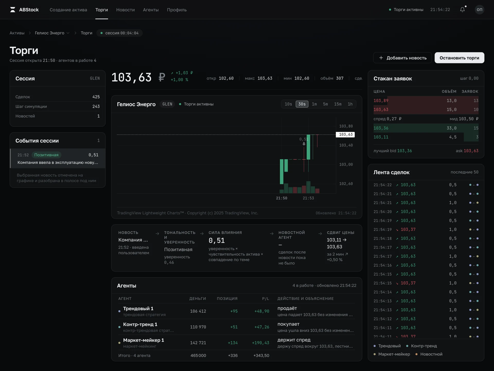
</div>

## Возможности

- Несколько рынков в одной сессии. Интерфейс позволяет создать до **8 активов** и выбрать от **1 до 32 агентов**, до **8 экземпляров каждой стратегии**.
- Общий денежный счёт каждого агента и отдельные позиции по активам. Резервирование денег и бумаг защищает от повторного расходования средств в разных рынках.
- Рыночные и лимитные заявки, частичное исполнение, отмена остатков и запрет сделок с самим собой.
- Новость с отдельным сигналом для каждого связанного актива. Новостной агент учитывает силу сигнала и сохраняет реакцию с затуханием до 10 шагов.
- Свечи с интервалами **10 с, 30 с, 1 мин, 5 мин, 15 мин и 1 ч**, стакан, лента сделок и статистика участников.
- Каталог активов, профили и история торгов в **SQLite**. После перезапуска история остаётся доступной.

Ограничения интерфейса на количество активов и агентов не являются измеренными пределами производительности движка.

## Как проходит шаг торгов

Для каждого активного рынка `SimulationRunner` получает снимок состояния, снимает старые заявки агентов и освобождает связанные с ними резервы. Затем последовательно вызывает стратегии, передаёт новые заявки биржевому движку, обновляет счета и сохраняет историю.

Агент может купить, продать или ждать. Решение о покупке ещё не означает сделку: для исполнения нужны встречная заявка и доступные ресурсы. При отсутствии новой сделки последняя цена сохраняется.

В интерфейсе между завершением обработки шагов установлена пауза **1 секунда**. Фактический период включает время обработки и эту паузу. Решения стратегий в торговом цикле пока обрабатываются последовательно. Анализ одной новости для разных активов запускается параллельно через `Task.WhenAll`.

## Четыре стратегии

Один экземпляр агента участвует в разных рынках со своим общим счётом и отдельными позициями. Для каждого актива стратегия учитывает его параметры и объясняет выбранное действие.

| Стратегия | Поведение |
|---|---|
| **Трендовая** | Покупает при достаточно сильном росте, продаёт при падении. При слабом сигнале ждёт. |
| **Контртрендовая** | Покупает после снижения и продаёт после роста. После нескольких шагов простоя возможна небольшая пробная заявка. |
| **Маркет-мейкер** | Поддерживает лимитные заявки на четырёх уровнях по обе стороны от ориентирной цены с учётом денег и позиции. |
| **Новостная** | Ждёт подходящей новости. Направление заявки определяет знак влияния, а объём зависит от силы сигнала, его возраста и доступных ресурсов. |

Перед запуском пользователь задаёт количество экземпляров каждого типа и денежный капитал одного экземпляра. Дополнительно каждому агенту выдаётся стартовая позиция **50 единиц каждого торгуемого актива**.

<div align="center">
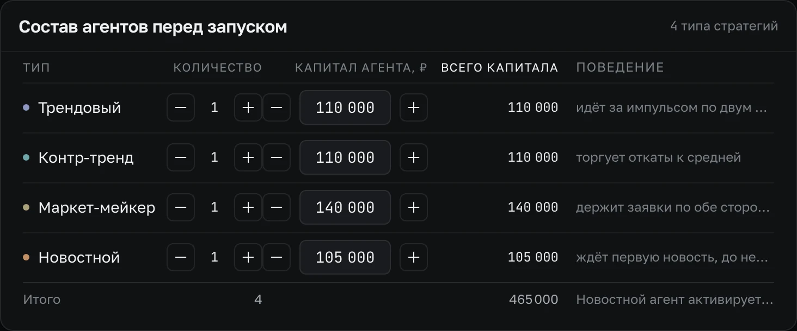
</div>

## Анализ новости

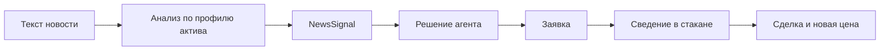

Сначала приложение строит профиль актива по описанию компании. `gpt-5.4-mini` возвращает 40 факторов, поровну позитивных и негативных. Приложение ранжирует их по смысловой близости к описанию и важности, затем оставляет по 10 факторов каждой категории.

Текущие модели и их роли:

| Модель | Задача | Где выполняется |
|---|---|---|
| `gpt-5.4-mini` | Генерация профиля компании | OpenAI, запрос из Python-сервиса |
| `text-embedding-3-large` | Векторное представление описания, факторов и новости | OpenAI, запрос из .NET |
| `Helsinki-NLP/opus-mt-ru-en` | Перевод русского текста на английский | Python-сервис |
| `ProsusAI/finbert` | Вероятности позитивной, нейтральной и негативной тональности | Python-сервис |
| `typeform/distilbert-base-uncased-mnli` | Проверка соответствия новости выбранным факторам, NLI | Python-сервис |

При анализе новости приложение переводит текст, получает эмбеддинг и отбирает факторы с косинусной близостью **строго выше 0,60**. Затем NLI оставляет те факторы, для которых оценка `entailment` выше оценок `neutral` и `contradiction`. FinBERT отдельно определяет тональность текста.

Для прошедших отбор факторов текущая формула имеет вид:

```text
ImpactScore = NewsSensitivity × Σ ((P(pos) − P(neg)) × Similarity × Importance)
```

Здесь `NewsSensitivity` — чувствительность актива, `Similarity` — близость новости и фактора, `Importance` — вес фактора в профиле. Знак вклада задаёт разность `P(pos) − P(neg)`. Категория фактора сама по себе знак вклада не меняет. Результат округляется до четырёх знаков.

`NewsSignal` содержит тональность, уверенность модели, силу влияния, среднюю близость, список факторов и объяснение. Текст новости анализируется для всех активов, которые сейчас торгуются. Каждый рынок получает собственный результат, а новостной агент проверяет достаточность связи и силы влияния перед выставлением заявки.

Сила влияния не является вероятностью роста цены. NLI проверяет соответствие текста фактору, а достоверность события требует внешних источников. Изменение цены зависит от реальных исполнений в симуляции.

## Экраны

Ниже приведены примеры отдельных сценариев интерфейса. Торги и карточка агента показывают выбранный актив, а состав участников и денежные счета относятся к общей сессии.

<table>
<tr>
<td width="50%">

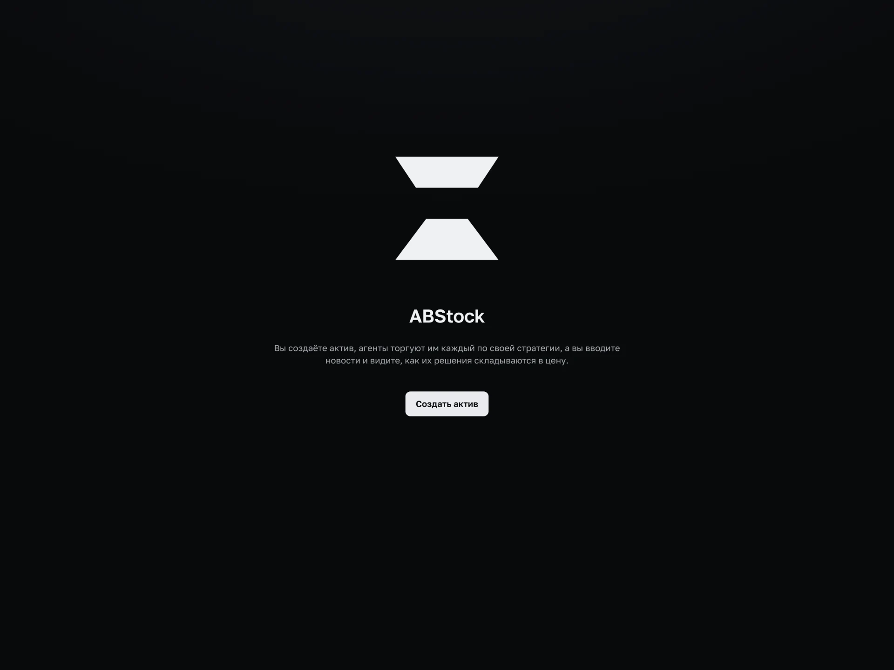

**Главная**<br>
Начальная страница и переход к работе с активами.

</td>
<td width="50%">

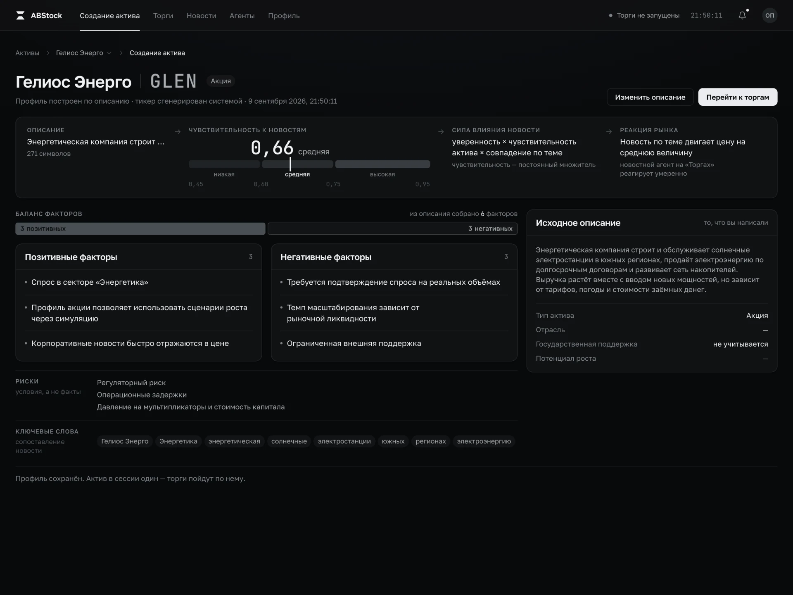

**Создание актива**<br>
Описание компании, параметры инструмента и профиль факторов. При недоступности AI приложение строит запасной профиль.

</td>
</tr>
<tr>
<td width="50%">

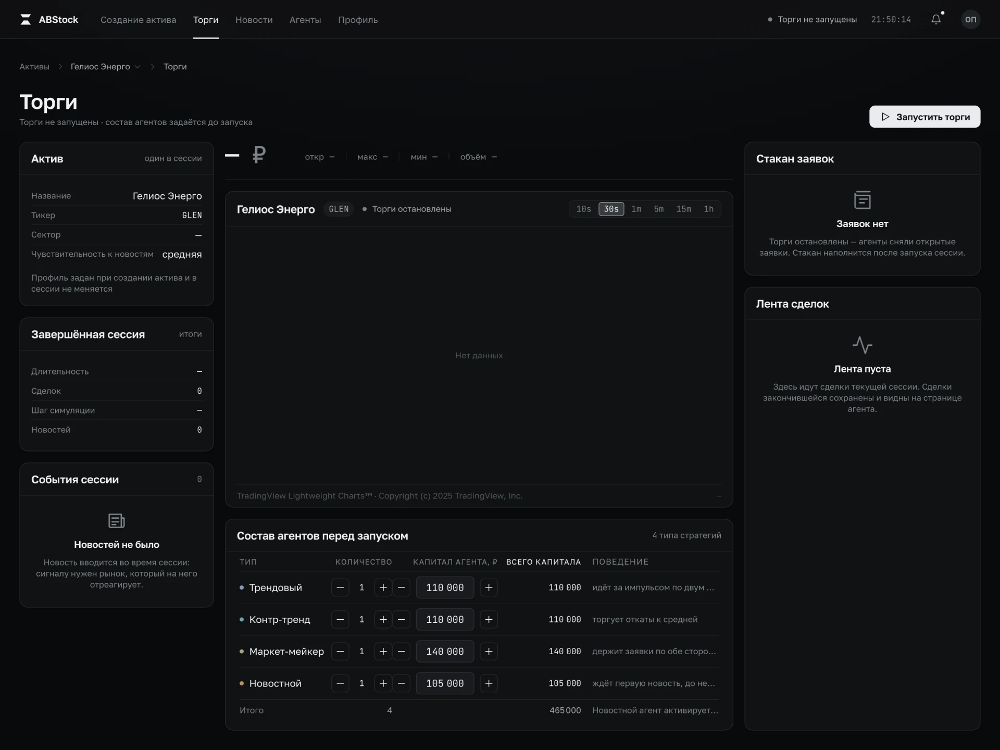

**Подготовка торгов**<br>
Количество экземпляров каждой стратегии, капитал и запуск сессии.

</td>
<td width="50%">

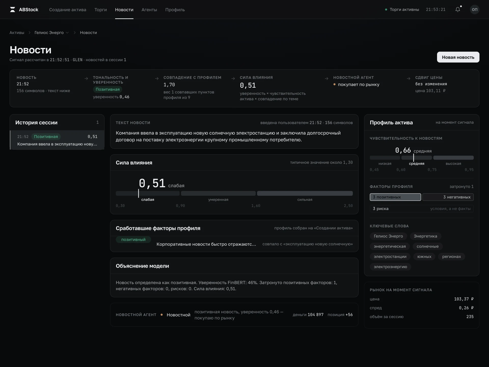

**Новости**<br>
Ввод текста, результаты анализа, связанные факторы и объяснение влияния на активы.

</td>
</tr>
<tr>
<td width="50%">

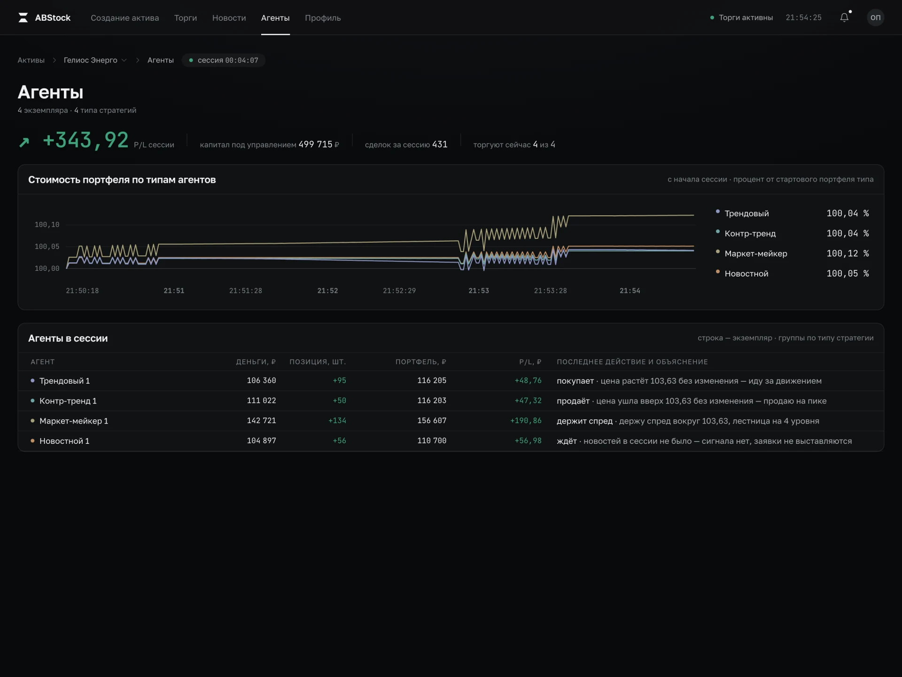

**Агенты**<br>
Состав участников, позиции и изменение стоимости портфелей по типам стратегий.

</td>
<td width="50%">

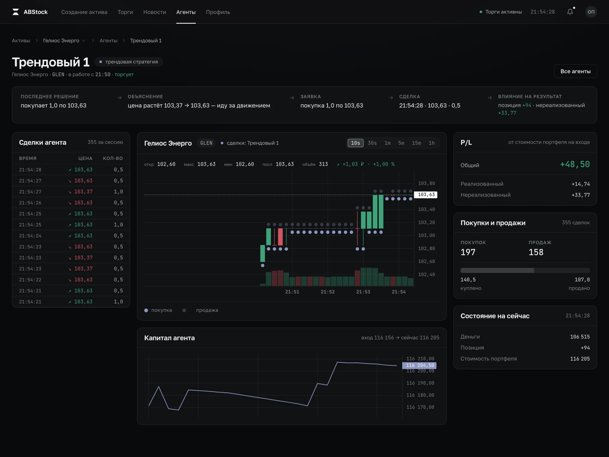

**Карточка агента**<br>
Сделки, метки исполнений на графике выбранного актива, реализованный и нереализованный P/L.

</td>
</tr>
</table>

## Архитектура

Основное приложение — модульный монолит на .NET 10 и Blazor Server. Модули .NET работают в одном процессе. Модели перевода, тональности и NLI обслуживает отдельный Python/FastAPI-сервис, с которым приложение общается по HTTP.

| Модуль | Ответственность |
|---|---|
| `ABStock.Shared` | Общие типы активов, заявок, сделок, счетов, снимков рынка и сигналов |
| `ABStock.Exchange` | Стакан, проверка заявок и сведение в сделки |
| `ABStock.Agents` | Общий интерфейс агента, фабрика и четыре стратегии |
| `ABStock.Application` | Каталог, рынки, общие счета, резервы и торговый цикл |
| `ABStock.AI` | Профили активов, перевод, сопоставление факторов и анализ новостей |
| `ABStock.Persistence` | Реализации хранения и чтения данных через EF Core и SQLite |
| `ABStock.UI` | Страницы Blazor, состояние интерфейса, графики и настройки |

Биржевой движок получает заявки, агент возвращает решение, а AI формирует `NewsSignal`. Счета, резервы и исполнение координирует слой приложения.

Торговая сессия, состав агентов, рынки, события и история портфеля общие для серверного процесса. Перезагрузка страницы или открытие второй вкладки не создают новый прогон. Выбранный актив принадлежит вкладке, настройки интерфейса хранятся в `localStorage` браузера.

### Персистентность

Персистентность означает, что данные сохраняются между запусками приложения. Модуль `ABStock.Persistence` использует Entity Framework Core и SQLite.

| Данные | Таблицы |
|---|---|
| Каталог активов, тикеры, параметры и профили факторов | `Assets`, профиль в JSON |
| Торговые сессии и связь рынка с активом | `TradingSessions`, `SessionMarkets` |
| Отдельные запуски рынков | `SimulationRuns` |
| Снимки цен, лучшие предложения и агрегаты торгов | `MarketTicks` |
| Исполненные сделки | `Trades` |

После перезапуска доступны каталог и записанная история. Текущий стакан, неисполненные заявки, денежные счета и состояние стратегий хранятся в памяти. Работающая сессия автоматически не возобновляется, для нового прогона торги запускаются заново.

## Запуск

Для основного приложения нужен **.NET 10 SDK**. Для AI дополнительно нужны Python, `venv`, `pip`, доступ к моделям Hugging Face и ключ OpenAI.

Из корня репозитория:

```bash
dotnet restore ABStock.slnx
dotnet run --project src/ABStock.UI --launch-profile http
```

Приложение откроется на [http://localhost:5062](http://localhost:5062). Адреса профилей находятся в `src/ABStock.UI/Properties/launchSettings.json`. Остановка сервера — `Ctrl+C` в его терминале.

Без Python-сервиса и ключа приложение тоже запускается. Каталог, биржа и стратегии доступны, профиль строится запасным алгоритмом, а при попытке анализа новости интерфейс показывает причину ошибки AI.

По умолчанию приложение создаёт `abstock.db` в рабочем каталоге хоста UI. Строку подключения можно переопределить переменной `ConnectionStrings__ABStock`.

### Настройка AI

**1. Установить зависимости Python.** Команды выполняются из корня репозитория.

macOS / Linux:

```bash
python3 -m venv src/ABStock.AI/Python/.venv
src/ABStock.AI/Python/.venv/bin/python -m pip install -r src/ABStock.AI/Python/requirements.txt
```

Windows, PowerShell:

```powershell
py -m venv src\ABStock.AI\Python\.venv
.\src\ABStock.AI\Python\.venv\Scripts\python.exe -m pip install -r src\ABStock.AI\Python\requirements.txt
```

При первом старте сервис загружает **FinBERT, DistilBERT-MNLI и OPUS-MT**. Для этого нужны доступ к Hugging Face и свободное место для весов моделей. Дождитесь загрузки всех моделей и сообщения Uvicorn о готовности.

**2. Передать ключ OpenAI обоим процессам.** .NET использует его для эмбеддингов, Python — для генерации профиля. В обоих терминалах задайте `OPENAI_API_KEY`:

macOS / Linux:

```bash
export OPENAI_API_KEY="<ваш ключ>"
```

Windows, PowerShell:

```powershell
$env:OPENAI_API_KEY="<ваш ключ>"
```

Для .NET ключ также можно хранить в user-secrets:

```bash
dotnet user-secrets set OpenAI:ApiKey "<ваш ключ>" --project src/ABStock.UI
```

Python не читает user-secrets. Альтернативный общий источник — локальный `.env` в корне репозитория с `OPENAI_API_KEY=...`: оба процесса его загружают. Файл исключён из Git. Значение переменной `OPENAI_API_KEY` имеет приоритет перед настройкой `.NET OpenAI:ApiKey`.

**3. Запустить Python-сервис в первом терминале.**

macOS / Linux:

```bash
cd src/ABStock.AI/Python
.venv/bin/python -m uvicorn main:app --host 127.0.0.1 --port 8000
```

Windows, PowerShell:

```powershell
cd src\ABStock.AI\Python
.\.venv\Scripts\python.exe -m uvicorn main:app --host 127.0.0.1 --port 8000
```

После старта описание API доступно на [http://127.0.0.1:8000/docs](http://127.0.0.1:8000/docs). Сервис предоставляет `POST /analyze`, `/translate`, `/translate-batch`, `/nli` и `/generate-profile`.

**4. Запустить .NET во втором терминале из корня репозитория.**

```bash
dotnet run --project src/ABStock.UI --launch-profile http
```

Адрес Python-сервиса задаётся настройкой `AI:ServiceUrl`, по умолчанию `http://127.0.0.1:8000`. Через окружение её можно переопределить как `AI__ServiceUrl`.

Если профиль собран запасным алгоритмом, причина есть в логе ABStock. Проверьте доступность Python-сервиса, загрузку моделей и наличие ключа в обоих процессах. `503 OPENAI_API_KEY is not set` относится к ключу Python-сервиса. Для полной остановки AI и интерфейса завершите оба процесса через `Ctrl+C`.

Первый сценарий: создать несколько активов, задать состав агентов, запустить торги, открыть рынок нужного актива и отправить новость о компании через страницу «Новости».

### Docker

Нужен запущенный Docker с поддержкой Linux-контейнеров. Из корня репозитория:

```bash
docker compose up --build
```

Приложение доступно на [http://localhost:5062](http://localhost:5062). Текущий Compose-файл запускает **только основное .NET-приложение**. Python-сервис при необходимости запускается отдельно.

Для запуска с AI через Docker Desktop сначала запустите Python на хосте с `--host 0.0.0.0` и настройте доступ к нему из контейнера. Задайте `OPENAI_API_KEY` в терминале Docker, затем вместо `docker compose up --build` выполните:

```bash
docker compose run --build --rm --service-ports -e OPENAI_API_KEY -e AI__ServiceUrl=http://host.docker.internal:8000 abstock
```

Команда передаёт ключ из окружения терминала и адрес Python в контейнер. Простая установка переменных окружения хоста перед `docker compose up` не передаст их внутрь: текущий Compose-файл их не объявляет.

SQLite хранится в томе `abstock-data`, ключи ASP.NET Core Data Protection — в `abstock-keys`. Сервис, запущенный через `docker compose up`, остановите командой:

```bash
docker compose down
```

Одноразовый контейнер `docker compose run --rm` завершите через `Ctrl+C` в его терминале. Команда `docker compose down` сохраняет именованные тома. `docker compose down --volumes` удалит их вместе с базой и ключами.

## Тесты

По результатам локального прогона **15 октября 2026 года**: **407 тестов пройдены, ошибок и пропусков нет**.

```bash
dotnet test ABStock.slnx --configuration Release
```

| Проект | Тестов | Что проверяет |
|---|--:|---|
| `ABStock.Exchange.Tests` | 50 | Стакан, сведение, валидация, приоритет и отображение заявок |
| `ABStock.Agents.Tests` | 33 | Четыре стратегии, поведение по активам, реакция на новости и объяснения |
| `ABStock.AI.Tests` | 10 | Отбор факторов, сила влияния, промпт, генерация и запасной профиль, регистрация сервисов |
| `ABStock.Application.Tests` | 148 | Каталог, несколько рынков, торговый цикл, общие счета, резервы и P/L |
| `ABStock.Persistence.Tests` | 35 | SQLite, сохранение и восстановление каталога и профилей, история нескольких рынков и совместимость схемы |
| `ABStock.UI.Tests` | 131 | Состояние сессии, выбранный актив, новости, события, статистика, настройки и параметры Razor |
| **Всего** | **407** | |

Тесты AI используют тестовые реализации внешних зависимостей. Для них не нужны ключ OpenAI, Python-сервис и загрузка моделей. Проверка реального AI выполняется отдельно при запуске приложения.

Для отчётов TRX и покрытия, как в CI:

```bash
dotnet test ABStock.slnx --configuration Release --logger trx --collect:"XPlat Code Coverage" --results-directory TestResults
```

### GitHub Actions

- **[CI](.github/workflows/ci.yml)** запускается на pull request, push в `main` и вручную. Он восстанавливает зависимости, собирает решение в Release, запускает тесты с покрытием, сохраняет отчёты, затем собирает Docker-образ и проверяет HTTP-ответ запущенного контейнера.
- **[Security](.github/workflows/security.yml)** проверяет изменения зависимостей в pull request, выполняет CodeQL для C# и аудит NuGet-пакетов. Проверки запускаются также при push в `main`, по недельному расписанию и вручную.

Результаты тестов и покрытия CI доступны в артефакте `test-results-<номер попытки>` соответствующего запуска. Python-модели и реальные запросы к OpenAI эти workflows не проверяют.

## Структура репозитория

```text
src/
  ABStock.Shared         общие контракты и модели
  ABStock.Exchange       стакан, валидатор и сведение заявок
  ABStock.Agents         фабрика агентов и четыре стратегии
  ABStock.Application    каталог, рынки, счета, резервы и SimulationRunner
  ABStock.AI             профили и анализ новостей
    Python/              FastAPI, перевод, FinBERT, NLI и генерация профиля
  ABStock.Persistence    EF Core, SQLite, каталог и история торгов
  ABStock.UI             Blazor Server, страницы, графики и настройки
tests/                   шесть тестовых проектов
.github/workflows/       CI, проверка контейнера и безопасности
assets/                  снимки экранов и графические материалы
```

## Интерфейс и дизайн-система

Цвета, типографика и размеры заданы в `src/ABStock.UI/wwwroot/design-system.css`. Основной текст использует `Golos Text`, числа — `JetBrains Mono` с табличными цифрами. Интерфейс работает с культурой `ru-RU`.

Рыночные цвета показывают сторону заявки, изменение цены и P/L. Пользовательский акцент меняет элементы управления отдельно от цветов рынка и стратегий. Настройки сохраняются в браузере.

<table>
<tr>
<td width="34%">

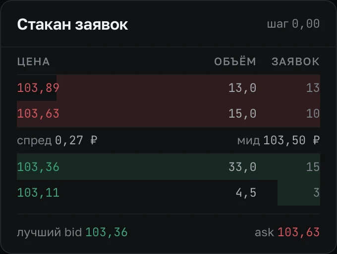

**Стакан**<br>
Предложения купить и продать, объём на уровне, спред и средняя котировка.

</td>
<td width="66%">

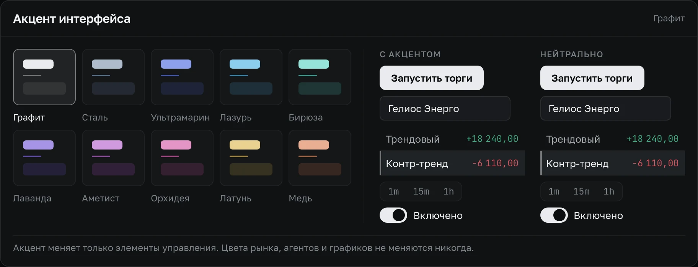

**Настройки оформления**<br>
Выбор акцента с предпросмотром элементов интерфейса.

</td>
</tr>
</table>

## Границы модели

ABStock предназначен для учебных экспериментов с торговыми стратегиями и новостными сигналами. Он не подключён к реальному брокеру. Механика рынка и стратегии упрощены, а результаты прогона зависят от начальных условий и состава участников. Нагрузочные пределы движка пока не измерены.

## Работа в команде

Правки выполняются в отдельных ветках и проходят pull request с ревью перед слиянием в `main`. В описании PR указываются изменение поведения, способ проверки и существенные ограничения. Для правок интерфейса нужно проверять состояния до создания актива, до запуска, во время торгов и после остановки.

---

<div align="center">
<sub>Учебный проект. Несколько активов, четыре типа стратегий и цена из исполненных сделок.</sub>
</div>
